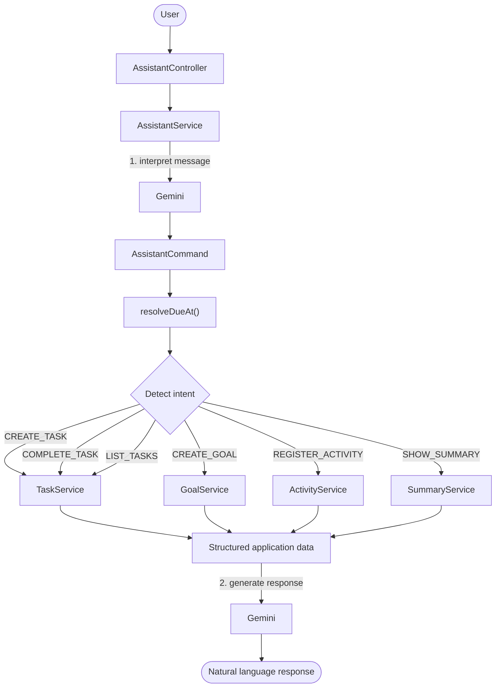

# ✨ Lume

**Um assistente pessoal de produtividade com IA, feito com Java e Spring Boot.**

Gerencie Tarefas (Tasks), Metas (Goals) e Atividades (Activities) por uma API REST — ou simplesmente converse com ele em linguagem natural.

🌐 [English](README.md) · **Português**

    

---

## 📌 Sobre

O Lume permite que o usuário registre o que quer fazer, o que quer alcançar e o que já fez, e entende mensagens como:

> *“Quero estudar Java por 10 horas essa semana.” · “Estudei Java por 1 hora hoje.” · “O que eu ainda tenho para fazer?”*

> *“I want to study Java for 10 hours this week.” · “I studied Java for 1 hour today.” · “What do I still have to do?”*

A ideia central do projeto é uma **separação rígida de responsabilidades**:

> 🧠 **A IA interpreta a intenção do usuário.**
>
> ⚙️ **O Java controla as regras de negócio e as operações no banco de dados.**

O modelo nunca acessa o banco de dados e nunca decide regras de negócio determinísticas. Ele apenas transforma texto livre em um comando estruturado, que é validado e executado por serviços Spring comuns.

## 📑 Sumário

- [Tecnologias](#-tecnologias)
- [Funcionalidades](#-funcionalidades)
- [O processo](#-o-processo)
- [O que aprendi](#-o-que-aprendi)
- [Como pode melhorar](#-como-pode-melhorar)
- [Como rodar o projeto](#-como-rodar-o-projeto)

---

## 🛠 Tecnologias

| Área | Tecnologia |
| --- | --- |
| Linguagem | Java 21 |
| Framework | Spring Boot 4.1.1 |
| Integração com IA | Spring AI 2.0.1 + Google Gemini |
| Banco de dados | PostgreSQL (H2 em memória quando nenhum datasource está configurado) |
| Persistência | Spring Data JPA + Hibernate |
| JSON | Jackson 3 (padrão do Spring Boot), mais o databind do Jackson 2 para um desserializador customizado |
| Build | Gradle |
| Testes | Spring Boot Test + MockMvc |
| Ferramentas | IntelliJ IDEA, Postman |

O `ChatClient` do Spring AI conecta a aplicação Java ao Gemini e é usado para obter **saída estruturada**, convertida diretamente em objetos Java.

---

## 🚀 Funcionalidades

### ✅ Gerenciamento de Tarefas

Uma Task representa algo que o usuário pretende fazer.

- Título e descrição
- Duração-alvo (`durationMinutes`)
- Prazo (`dueAt`)
- Status: `PENDING`, `RUNNING`, `COMPLETED`, `CANCELED`
- Data de conclusão (`completedAt`)
- Progresso calculado a partir das Activities relacionadas

Quando a soma das Activities relacionadas atinge a duração-alvo da Task, ela é **marcada automaticamente como concluída**. Uma Task cancelada **permanece cancelada**, mesmo que Activities sejam adicionadas ou alteradas depois.

> Exemplo: uma Task com alvo de 120 minutos e duas Activities de 60 minutos cada chega a 100% e passa a `COMPLETED`.

### 🎯 Gerenciamento de Metas

Um Goal é um objetivo mensurável acompanhado ao longo de um período.

- Título e descrição
- Período (`goalPeriod`): `DAILY`, `WEEKLY`
- Valor-alvo e unidade: `MINUTES`, `HOURS`, `DAYS`, `TIMES`
- Progresso e percentual calculados

Exemplos:

- Estudar Java por 10 horas nesta semana
- Praticar programação 5 vezes nesta semana
- Estudar 30 minutos todos os dias

### 📝 Gerenciamento de Atividades

Uma Activity é algo que o usuário **já fez**.

- Descrição, duração e data
- Task opcional e Goal opcional

```
Independent  ──  Linked to a Task  ──  Linked to a Goal  ──  Linked to both
```

Criar, atualizar ou excluir uma Activity dispara o recálculo do progresso da Task e do Goal relacionados.

### 📊 Acompanhamento de Progresso

O progresso é **derivado das Activities**, nunca informado manualmente.

| Unidade-alvo | Como o progresso é calculado |
| --- | --- |
| Task (minutos) | Soma das durações das Activities |
| `MINUTES` | Soma das durações das Activities |
| `HOURS` | Soma das durações ÷ 60 |
| `TIMES` | Número de Activities |
| `DAYS` | Número de datas distintas de Activities |

O resultado é convertido em um percentual do valor-alvo.

### 🗓 Resumos

Resumos estruturados gerados pelo Java e apresentados de forma natural pelo Lume.

- **Períodos:** `DAILY`, `WEEKLY`, `MONTHLY`
- **Tipos:**
    - `ACTIVITY` — o que o usuário já fez
    - `PENDING` — Tasks e Goals pendentes

Exemplos: *“O que eu fiz essa semana?”* · *“O que eu ainda tenho para fazer?”*

### 💬 Assistente em Linguagem Natural

O Lume interpreta mensagens como:

```
Quero estudar Java hoje por 2 horas.
Quero estudar Java por 10 horas essa semana.
Estudei Java por 1 hora hoje.
Concluí a tarefa de estudar Java.
O que eu ainda tenho para fazer?

============================================

I want to study Java today for 2 hours.
I want to study Java for 10 hours this week.
I studied Java for an hour today.
I did the Java Study task.
What do I still have to do?
```

Intenções suportadas:

| Intenção | Finalidade |
| --- | --- |
| `CREATE_TASK` | Criar uma Task |
| `CREATE_GOAL` | Criar um Goal |
| `REGISTER_ACTIVITY` | Registrar algo já feito |
| `COMPLETE_TASK` | Marcar uma Task como concluída |
| `LIST_TASKS` | Listar Tasks |
| `SHOW_SUMMARY` | Mostrar um resumo de atividades ou de pendências |
| `UNKNOWN` | Mensagem não compreendida |

---

## 🔄 O processo

A aplicação mantém uma fronteira clara entre **interpretação pela IA** e **lógica de negócio**.



### 1. Interpretação pela IA

A primeira requisição ao Gemini apenas entende a intenção do usuário. Por exemplo:

```
"Quero estudar Java por 10 horas essa semana"
"I want to study Java for 10 hours this week."
```

vira (de forma simplificada):

```json
{
  "intent": "CREATE_GOAL",
  "title": "Estudar Java", // Study Java
  "targetValue": 10,
  "targetUnit": "HOURS",
  "goalPeriod": "WEEKLY"
}
```

O modelo **não modifica o banco de dados**.

### 2. Tratamento de saída imperfeita do modelo

O `AssistantCommand` agrupa campos usados por operações diferentes, então o modelo pode ocasionalmente preencher campos que não pertencem à intenção detectada. O `AssistantService.process()` usa a intenção para escolher um ramo, e cada ramo lê apenas os campos da sua própria operação, de modo que qualquer outra coisa preenchida pelo modelo é ignorada.

| Intenção | Campos lidos |
| --- | --- |
| `CREATE_TASK` | `title`, `description`, `durationMinutes`, `dueAt`, `localDate` |
| `CREATE_GOAL` | `title`, `description`, `goalPeriod`, `targetValue`, `targetUnit` |
| `REGISTER_ACTIVITY` | `description`, `durationMinutes`, `localDate`, `taskId`, `goalId` |
| `COMPLETE_TASK` | `title`, `description`, `localDate` |
| `LIST_TASKS` | nenhum — todas as Tasks são retornadas |
| `SHOW_SUMMARY` | `summaryType`, `summaryPeriod` |

A resposta é solicitada como saída estruturada com validação de schema, e o `resolveDueAt()` trata um `dueAt` vazio ou a string literal `"null"` como valor ausente.

A IA fornece a interpretação; o Java garante a consistência.

### 3. Lógica de negócio

O comando é executado pelo serviço apropriado. Os serviços são responsáveis por:

- Validação
- Acesso aos repositórios
- Criação e atualização de entidades
- Cálculos de progresso
- Mudanças de status
- Gerenciamento de relacionamentos

### 4. Tratamento de datas

A data atual é enviada ao modelo dinamicamente, e as regras são explícitas:

- Data sem horário → a data é retornada e `dueAt` pode ser `null` (o Java interpreta como o fim daquele dia, 23:59:59).
- Horário explícito → `dueAt` guarda a data e a hora reais.
- **A IA nunca inventa um horário que o usuário não informou.**

### 5. Resposta final

O Java primeiro monta um DTO estruturado, por exemplo:

```
PendingSummary
 ├── pendingTasks
 └── pendingGoals
```

Esses dados são enviados ao Gemini, que escreve a resposta final. Isso evita mensagens fixas no código Java **e** impede que a IA invente informações do banco de dados.

```
Database → Java Services → Structured DTO → Gemini → Natural language
```

---

## 📚 O que aprendi

### Arquitetura Spring Boot

Organizar uma aplicação nas camadas **Controller, Service, Repository, Entity, DTO, Exception e Configuration**, e por que as regras de negócio pertencem à camada de serviço em vez de ficarem espalhadas por controllers ou entidades.

### Relacionamentos JPA

Implementar `Activity → Task` e `Activity → Goal` com chaves estrangeiras anuláveis, e entender como atualizações diferem de inserções quando os relacionamentos podem mudar. Mover uma Activity do Goal A para o Goal B, por exemplo, exige recalcular **os dois** Goals.

### Dados derivados

Calcular o progresso a partir das Activities, em vez de armazenar valores duplicados, mantém as Activities como única fonte da verdade e reduz inconsistências.

```
Activity 60 min + Activity 40 min + Activity 20 min
                    ↓
          Task progress = 120 min
                    ↓
              Task = COMPLETED
```

### DTOs

Separar a representação externa da API das entidades internas. Isso se tornou especialmente importante com a IA, já que o modelo trabalha por meio do `AssistantCommand`, enquanto o restante da aplicação mantém seus próprios DTOs de requisição e resposta.

### Spring AI

Usar o `ChatClient` para enviar instruções de sistema e mensagens do usuário, injetar dados dinâmicos (como a data atual), solicitar saída estruturada, converter respostas em objetos Java e gerar respostas em linguagem natural a partir de dados estruturados. Também me mostrou a importância de **validar a saída imperfeita do modelo antes de executar qualquer operação de negócio**.

É importante dizer que a IA consome tokens rapidamente, então não consigo testar a função de resumo corretamente, pois ela usa todos os tokens disponíveis do dia, já que uso um plano gratuito — mas é claro que isso pode ser resolvido no futuro.

### IA e lógica de negócio determinística

A IA consegue entender *“Estudei Java por duas horas”* / *“I have studied Java for 2 hours”*, mas é o Java que decide:

- Qual Activity deve ser criada?
- Qual Goal deve ser atualizado?
- Como o progresso é calculado?
- Uma Task deve passar a concluída?

Isso separa o comportamento probabilístico da IA do comportamento determinístico da aplicação.

### Testes

Escrever testes de integração com Spring Boot e MockMvc para validar que as Activities afetam o progresso da Task e que as Tasks são concluídas quando a duração-alvo é atingida.

---

## 🔮 Como pode melhorar

| Melhoria | Descrição |
| --- | --- |
| **Múltiplas operações** | Tratar mensagens como *“Crie uma meta de estudar Java por 10 horas essa semana e uma meta de estudar segurança por 5 horas”* / *“Create a goal of studying Java for 10 hours this week and a goal of studying cybersecurity for 5 hours”*, retornando uma lista de comandos estruturados em vez de um único `AssistantCommand`. |
| **Decomposição Goal → Task** | Transformar um Goal (ex.: 10 horas de Java nesta semana) em Tasks menores distribuídas ao longo da semana: o Goal é o objetivo, as Tasks são as ações concretas. |
| **Memória de conversa** | Manter o contexto da conversa para que o usuário possa dizer *“Divida ela em tarefas”* / *“Divide it in tasks”* depois de criar um Goal. Tasks, Goals e Activities continuam no PostgreSQL; a memória guarda apenas o contexto da conversa. |
| **Resolução de entidades** | Resolver entidades a partir da linguagem natural em vez de IDs (*“Concluí a tarefa de estudar Java”* / *“I did the Study Java task”*), com busca e desambiguação quando várias Tasks forem parecidas. |
| **Interação por voz** | Speech-to-Text → Lume → Text-to-Speech. |
| **Frontend** | Painel de Tasks, progresso de Goals, histórico de Activities, relatórios, interface de chat e controles de voz. |
| **Deploy** | Rodar como um serviço acessível remotamente: Frontend → Backend API → PostgreSQL → Gemini API. |

---

## ▶ Como rodar o projeto

### Requisitos

- Java 21
- PostgreSQL
- Git
- IntelliJ IDEA (ou outra IDE Java)
- Uma chave de API do Google Gemini

### 1. Clone o repositório

```bash
git clone https://github.com/G-Delboni/AITaskAssistant.git
cd AITaskAssistant
```

### 2. Configure o banco de dados

Crie um banco PostgreSQL e defina a conexão em `src/main/resources/application.properties`:

```
spring.datasource.url=jdbc:postgresql://localhost:5432/aiassistant
spring.datasource.username=postgres
spring.datasource.password=your_password
```

O `application.properties` do repositório não define um datasource. Sem essas propriedades, o Spring Boot usa o banco H2 em memória que também está no classpath, e os dados são perdidos quando a aplicação para.

### 3. Configure o Gemini

Nunca faça commit da chave de API. Defina-a como variável de ambiente:

```bash
export GEMINI_API_KEY=your_api_key
```

Ela já é referenciada na configuração:

```
spring.ai.google.genai.api-key=${GEMINI_API_KEY}
spring.ai.google.genai.chat.model=gemini-3.6-flash
```

### 4. Rode a aplicação

```bash
./gradlew bootRun
```

No Windows:

```bash
gradlew.bat bootRun
```

Ou execute a classe principal do Spring Boot diretamente pelo IntelliJ IDEA. A API ficará disponível em `http://localhost:8080`.

### 5. Experimente

Use o Postman ou qualquer cliente HTTP. O endpoint do assistente é:

```
GET /assistant?message=Quero estudar Java hoje por 2 horas
GET /assistant?message=I wanna study Java for 2 hours today
```

Os endpoints REST são `/tasks`, `/goals` e `/activities`.

### 6. Rode os testes

```bash
./gradlew test
```

Os testes de integração usam o MockMvc contra os endpoints de Task e Activity e não chamam o endpoint do assistente.
